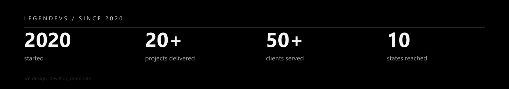

  

  
  
  
  

---

Software engineer in São Paulo — electrical engineer and electronic technician by training. I founded **[Legendevs](https://www.legendevs.com.br)** in 2020 to turn ideas into platforms that actually run a business: less spreadsheet, more system; less leftover software, more something you can scale.

I don't ship the obvious. I design, develop, and deliver products that automate the operation, cut manual work, and leave a result you can measure.

---

## Latest work

Work shipped through Legendevs — custom platforms, not templates.

| Project | What it is |
| --- | --- |
| **[Blue Sea Hotel](https://blueseahotel.com.br)** | Oceanfront hotel in Itapema — suites, events, and reservations on a surface that has to feel like the stay. |
| **[Houser](https://houser.com)** | Home-services platform: instant estimate in 10 seconds, vetted pros, protected payment, AI + satellite. |
| **[Linzmeyer Neto Advocacia](https://linzmeyer-website.vercel.app/)** | Law-firm site for Florianópolis and Curitiba — tradition, innovation, and a contact flow that converts. |
| **[Verifica](https://apps.apple.com/br/app/verifica/id6754730030)** | iOS app that turns a receipt photo into a warranty record — AI extraction, expiry alerts, extended-warranty marketplace. |
| **[Gênio Pro](https://portal.geniopro.com.br)** | Comex operations portal — every shipment from origin to destination, process and data under control. |
| **[Aram Trust](https://aramtrust.com.br)** | Customs broker since 2013 — clearance, international freight, and Comex in plain language. |
| **[TCA Transportes](https://www.tcatransportes.com.br/)** | Logistics platform with live tracking. |
| **[FORCE YACHTS](https://forceyachts.com/)** | Luxury yacht site — gallery, quotes, the kind of surface that has to feel expensive. |
| **[MEMORIZU](https://memorizu.com.br/)** | Product for keeping and sharing family memory. |
| **[ÚNICA Mineração](https://www.unicamineracao.com.br/)** | Corporate portal with operations dashboard and technical reports. |
| **[Hotel do Valle](https://www.hoteldovalle.com.br/)** | Booking, payments, and lodging in one flow. |
| **[Colégio Espaço](https://www.colegioespaco.com.br/)** | School portal — student area, academic ops, family communication. |
| **[VIDROFORT](https://www.vidrofort.com.br/)** | Institutional site for a 30-year glass company. |
| **Aromas** | School-meal operations, end to end. In development. |
| **FAST Translation** | Sworn-translation quotes, automated. In development. |

[Full archive →](https://www.legendevs.com.br/#clients)

## Numbers

  

| | |
| --- | --- |
| **2020** | the year Legendevs started |
| **20+** | projects delivered |
| **50+** | clients served |
| **10** | Brazilian states reached |

## What I take on

- **Custom development** — a system built for the operation you actually have, not a generic one you have to live around.
- **Specialized consultancy** — architecture and product decisions that hold when the company grows.
- **Multi-tenant platforms** — one codebase, many clients, without leaking trust.
- **Long-term partnership** — I stay after launch. Support, iteration, the next version.

Ordinary is not enough. If the process still lives in a spreadsheet, that is the product.

## Stack

- **Languages** — TypeScript · JavaScript · Dart
- **App** — React · Next.js · Node · Express · Flutter
- **Data** — PostgreSQL · Prisma · Firebase
- **Cloud** — AWS · Vercel · Docker · Nginx
- **Quality** — Jest · Cypress · Testing Library · SonarQube
- **Craft** — Figma · Git · GitHub · GitLab

## Hiring me

Available for product work and long-term partnerships. Prefer building the system that replaces the workaround.

[bruno@legendevs.com.br](mailto:bruno@legendevs.com.br) · [legendevs.com.br](https://www.legendevs.com.br) · [LinkedIn](https://www.linkedin.com/in/brunodin/)
