

  

  
  
  

---

Software engineer in São Paulo — electrical engineer and electronic technician by training. I founded **[Legendevs](https://www.legendevs.com.br)** in 2020 to turn ideas into platforms that actually run a business: less spreadsheet, more system; less leftover software, more something you can scale.

I don't ship the obvious. I design, develop, and deliver products that automate the operation, cut manual work, and leave a result you can measure.

---

## Latest work

Work shipped through Legendevs — custom platforms, not templates.

<table>
  <tr>
    <td width="50%" valign="top">
      <a href="https://linzmeyer-website.vercel.app/">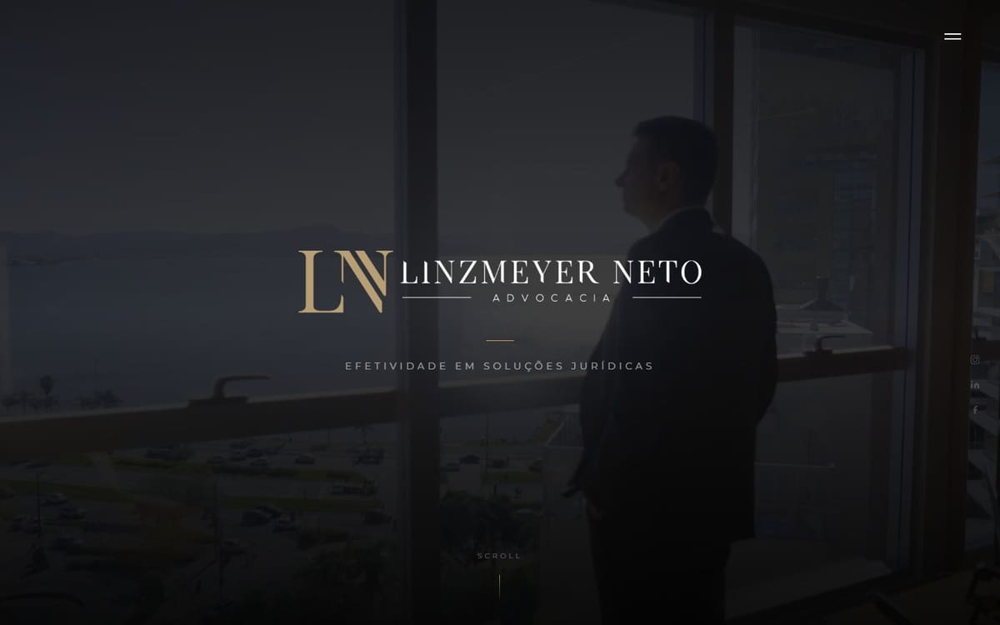</a>
       <b><a href="https://linzmeyer-website.vercel.app/">Linzmeyer Neto Advocacia</a></b>
       Law firm in Florianópolis and Curitiba. Tradition, innovation, and a contact flow that converts.
    </td>
    <td width="50%" valign="top">
      <a href="https://aramtrust.com.br">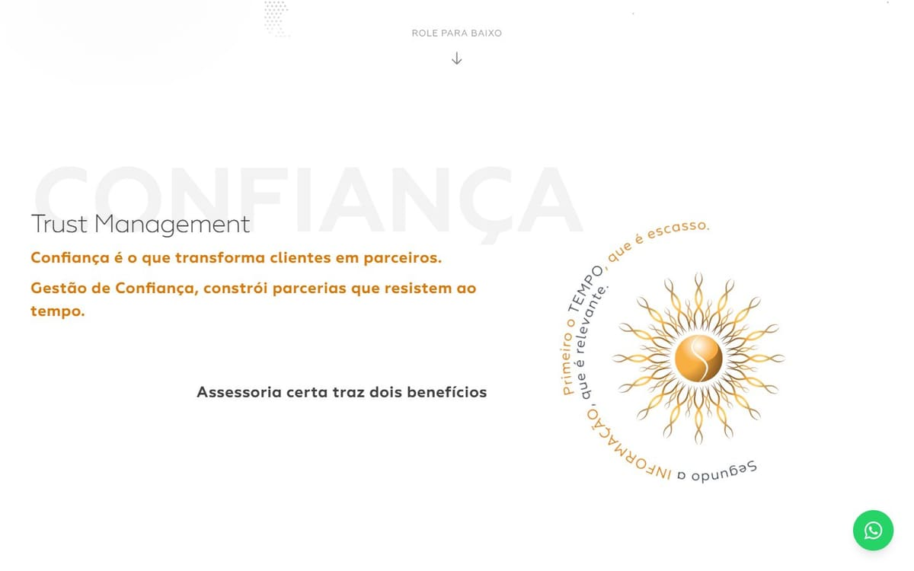</a>
       <b><a href="https://aramtrust.com.br">Aram Trust</a></b>
       Customs broker since 2013. Clearance, international freight, and Comex in plain language.
    </td>
  </tr>
  <tr>
    <td width="50%" valign="top">
      <a href="https://quidin.com.br">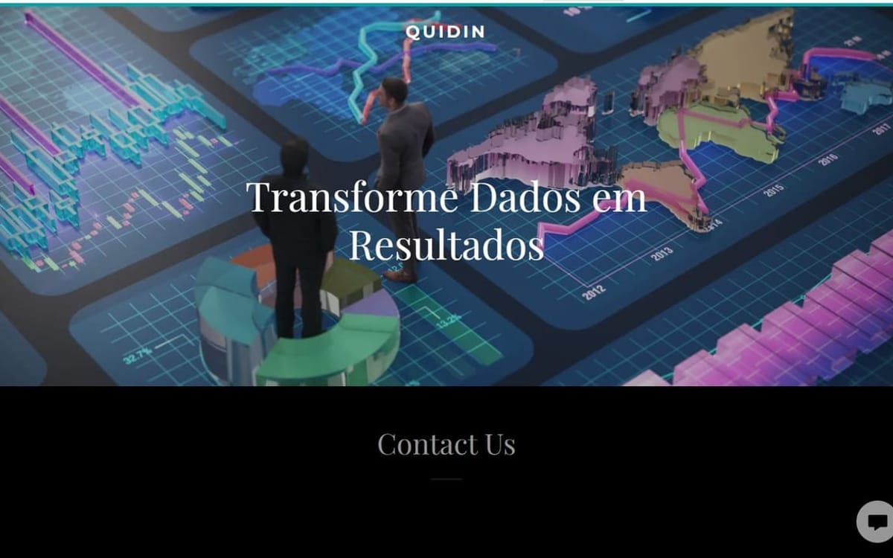</a>
       <b><a href="https://quidin.com.br">Quidin</a></b>
       Digital platform built to turn data into results.
    </td>
    <td width="50%" valign="top">
      <a href="https://teteach.legendevs.com.br">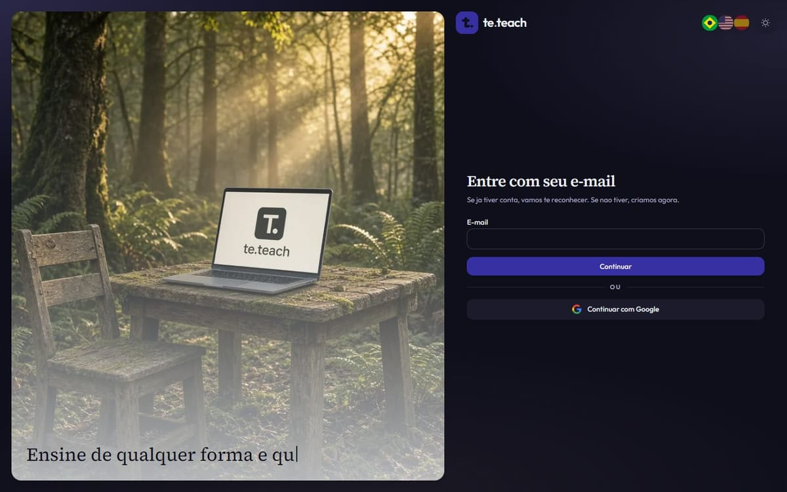</a>
       <b><a href="https://teteach.legendevs.com.br">te.teach</a></b>
       Teaching platform. Sign in and open your classes.
    </td>
  </tr>
  <tr>
    <td width="50%" valign="top">
      <a href="https://blueseahotel.com.br">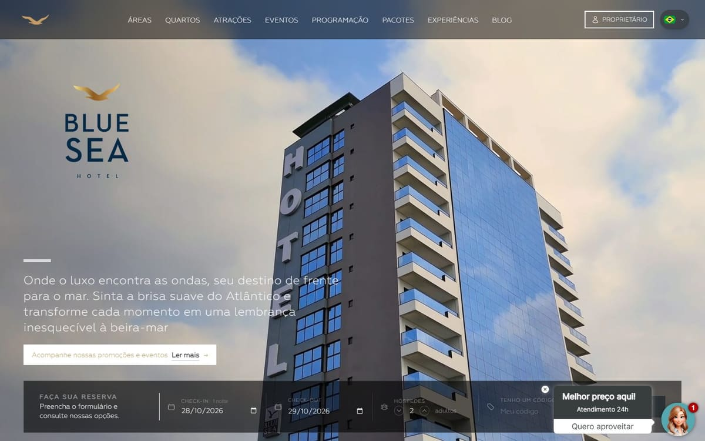</a>
       <b><a href="https://blueseahotel.com.br">Blue Sea Hotel</a></b>
       Oceanfront hotel in Itapema. Suites, events, and reservations.
    </td>
    <td width="50%" valign="top">
      <a href="https://houser.com">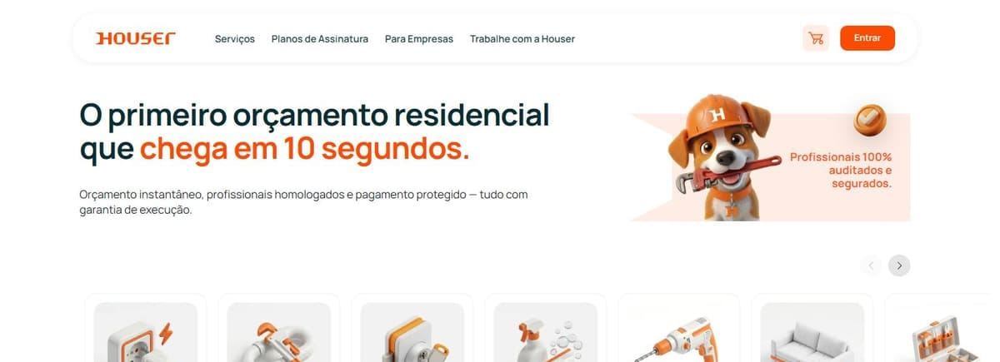</a>
       <b><a href="https://houser.com">Houser</a></b>
       Home services with an estimate in 10 seconds, vetted pros, and protected payment.
    </td>
  </tr>
  <tr>
    <td width="50%" valign="top">
      <a href="https://apps.apple.com/br/app/verifica/id6754730030">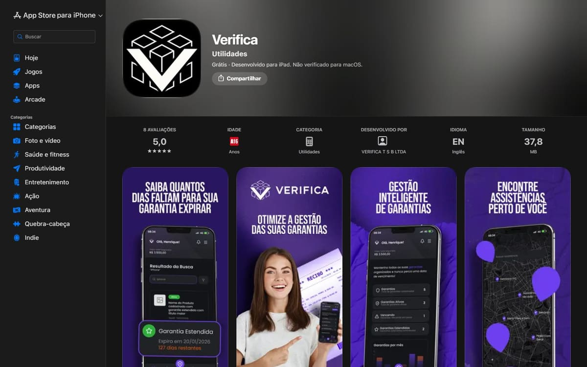</a>
       <b><a href="https://apps.apple.com/br/app/verifica/id6754730030">Verifica</a></b>
       iOS app that turns a receipt photo into a warranty record.
    </td>
    <td width="50%" valign="top">
      <a href="https://portal.geniopro.com.br">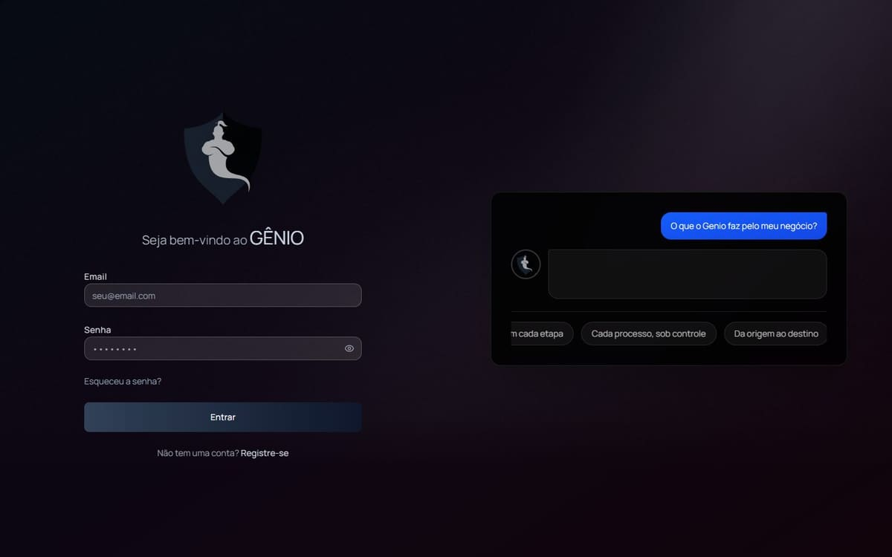</a>
       <b><a href="https://portal.geniopro.com.br">Gênio Pro</a></b>
       Comex portal. Every shipment from origin to destination, under control.
    </td>
  </tr>
  <tr>
    <td width="50%" valign="top">
      <a href="https://www.tcatransportes.com.br/">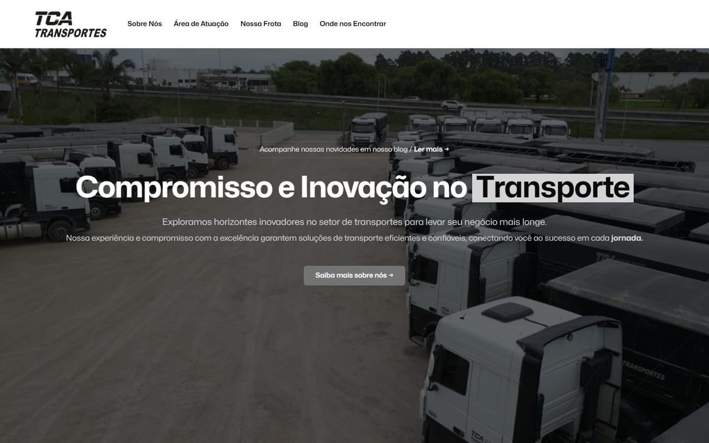</a>
       <b><a href="https://www.tcatransportes.com.br/">TCA Transportes</a></b>
       Logistics platform with live tracking.
    </td>
    <td width="50%" valign="top">
      <a href="https://forceyachts.com/">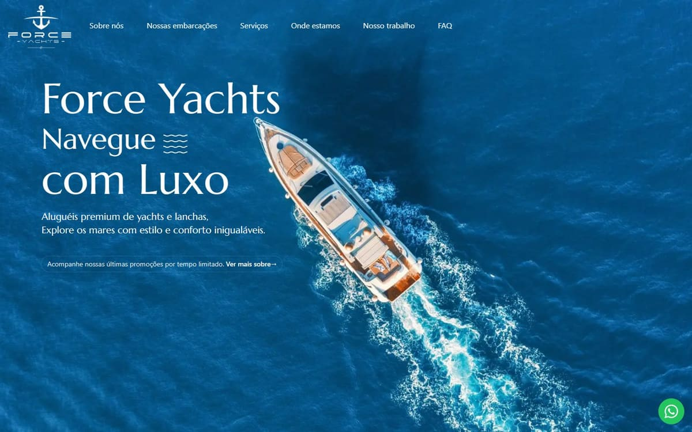</a>
       <b><a href="https://forceyachts.com/">Force Yachts</a></b>
       Luxury yacht site. Gallery, quotes, a surface that has to feel expensive.
    </td>
  </tr>
  <tr>
    <td width="50%" valign="top">
      <a href="https://www.unicamineracao.com.br/">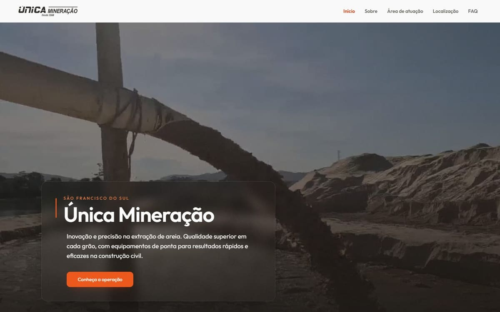</a>
       <b><a href="https://www.unicamineracao.com.br/">Única Mineração</a></b>
       Corporate portal with operations and technical presence.
    </td>
    <td width="50%" valign="top">
      <a href="https://www.hoteldovalle.com.br/">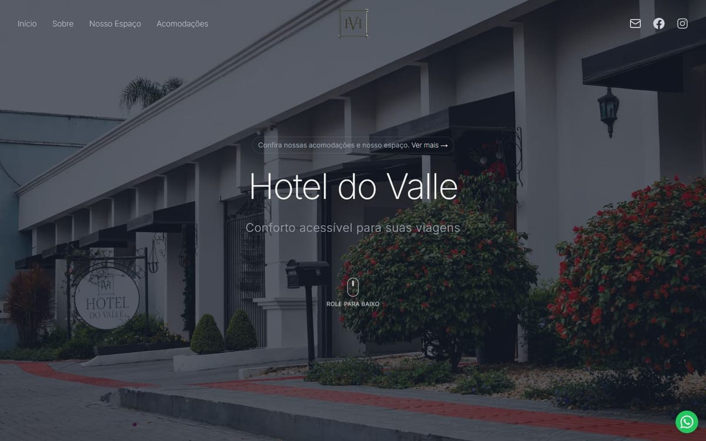</a>
       <b><a href="https://www.hoteldovalle.com.br/">Hotel do Valle</a></b>
       Booking, payments, and lodging in one flow.
    </td>
  </tr>
  <tr>
    <td width="50%" valign="top">
      <a href="https://www.colegioespaco.com.br/">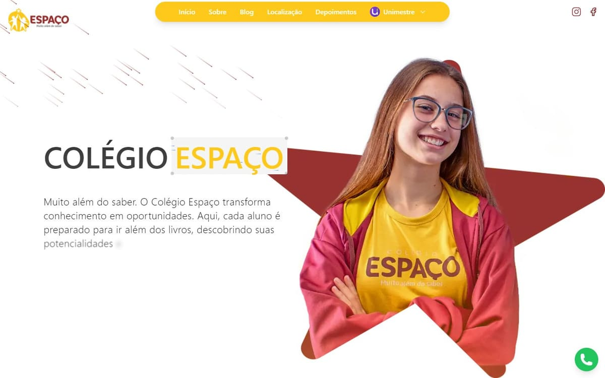</a>
       <b><a href="https://www.colegioespaco.com.br/">Colégio Espaço</a></b>
       School portal. Student area, academic ops, family communication.
    </td>
    <td width="50%" valign="top">
      <a href="https://www.vidrofort.com.br/">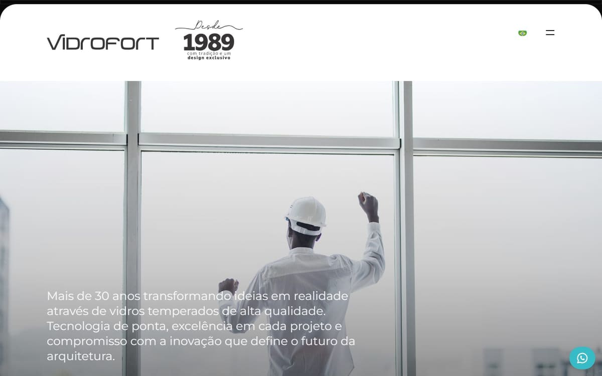</a>
       <b><a href="https://www.vidrofort.com.br/">Vidrofort</a></b>
       Institutional site for a glass company with more than 30 years in the market.
    </td>
  </tr>
</table>

Also shipped: **Memorizu** · **Aromas** · **FAST Translation**.

[Full archive →](https://www.legendevs.com.br/#clients)

## Numbers

  

| | |
| --- | --- |
| **2020** | the year Legendevs started |
| **20+** | projects delivered |
| **50+** | clients served |
| **10** | Brazilian states reached |

## What I take on

- **Custom development** — a system built for the operation you actually have, not a generic one you have to live around.
- **Specialized consultancy** — architecture and product decisions that hold when the company grows.
- **Multi-tenant platforms** — one codebase, many clients, without leaking trust.
- **Long-term partnership** — I stay after launch. Support, iteration, the next version.

Ordinary is not enough. If the process still lives in a spreadsheet, that is the product.

## Stack

- **Languages** — TypeScript · JavaScript · Dart
- **App** — React · Next.js · Node · Express · Flutter
- **Data** — PostgreSQL · Prisma · Firebase
- **Cloud** — AWS · Vercel · Docker · Nginx
- **Quality** — Jest · Cypress · Testing Library · SonarQube
- **Craft** — Figma · Git · GitHub · GitLab

## Hiring me

Available for product work and long-term partnerships. Prefer building the system that replaces the workaround.

[bruno@legendevs.com.br](mailto:bruno@legendevs.com.br) · [legendevs.com.br](https://www.legendevs.com.br) · [LinkedIn](https://www.linkedin.com/in/brunodin/)
